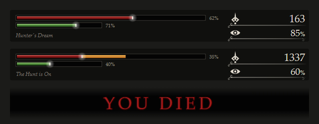

<div align="center">

# 🩸 bloodborne-hud

**A Hunter's HUD for the Claude Code desktop app.**

*Fear the Old Blood. And the context window.*



</div>

---

`bloodborne-hud` draws a Bloodborne-style HUD in the band above the prompt of the Claude Code **desktop app**, fed by your real session data. Thin bars with the pale glint at their tip, the orange *rally* where life was just lost, Blood Echoes and Insight in the corner with their ornaments, and a **YOU DIED** when the context is about to run out.

## What each part means

| In the game | In Claude Code |
| --- | --- |
| 🟥 **HP** (the long red bar) | **Context left** in this conversation. When it drops, the lost part flashes orange like a rally. |
| 🟩 **Stamina** (the short green bar) | What is left of your **5-hour usage limit**. |
| 👁 **Insight** | How much of your **weekly usage limit** you have spent, in %. It rises as you use Claude, like Insight (madness) in the game. |
| 🩸 **Blood Echoes** | How many **tools Claude has used** in this conversation. |
| *Hunter's Dream* / *The Hunt is On* | Claude idle / Claude working. |
| **YOU DIED** | Context at 95% or more: time to `/compact` or start a fresh session. |

The limits only arrive after Claude's first reply in a session, so Stamina and Insight show `—` until then.

## Install

### Claude Code desktop app

1. Download [`bloodborne-hud.zip`](https://github.com/JGois1/Bloodborne-hud-claude/raw/main/bloodborne-hud.zip).
2. **Settings → Plugins → Add → Upload a plugin**, pick the zip and turn it on.
3. Restart Claude and open a new session.

### Claude Code CLI

```
/plugin install bloodborne-hud --marketplace JGois1/Bloodborne-hud-claude
```

The HUD is drawn in the desktop app; in a terminal the mod only sets a status line.

## Commands

| Command | What it does |
| --- | --- |
| `/hud` | Shows every value the HUD draws, plus diagnostics (whether the band is being drawn, last error). |

The same numbers also go to the status line: `HP 62% · STA 71% · Blood Echoes 163`.

## Plays well with

- [**pet**](https://github.com/gmorubio/claude-mods/tree/main/pet): the HUD sits on top, the pet stays under it.

## How it's built

A single hooks module, [`plugins/bloodborne-hud/hooks/register.tsx`](plugins/bloodborne-hud/hooks/register.tsx):

- `$.session.usage()` gives the context fill and the 5-hour / weekly windows; `$.session.messages()` counts the tool uses.
- The HUD is one SVG, redrawn from scratch in vector shapes (no game assets), handed to the `AbovePrompt` band.

## Privacy

Everything stays on your machine: the mod makes no network requests and sends nothing anywhere.

## Disclaimer

A fan-made mod, not affiliated with or endorsed by FromSoftware or Sony Interactive Entertainment. *Bloodborne* is their trademark. All shapes are original vector drawings inspired by the game's HUD.

## License

[MIT](LICENSE)

---

<div align="center"><sub><i>"A hunter must hunt."</i></sub></div>
